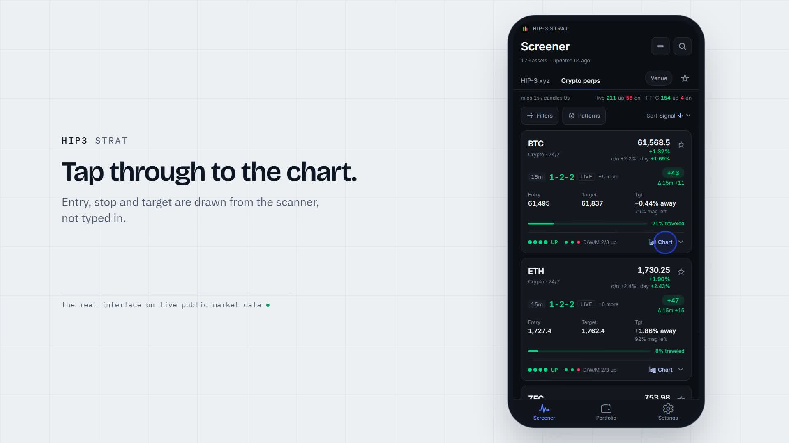
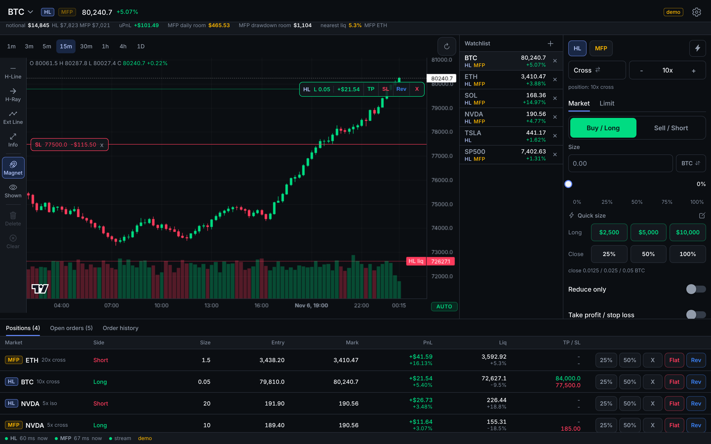

# HIP3 STRAT

A scanner, an alert feed and a trading surface you can run from your pocket.

An always-on market scanner pushes sharp moves, volume spikes, price levels
and setups to your phone and watch. A mobile app shows your Hyperliquid and
MyFundedPerps positions side by side, with a guarded close and reverse. A
chart-first terminal trades both.

Alerts are high-priority push messages, so they arrive with the phone locked
and the screen off. There is no separate watch app: a watch paired to the
phone shows the same notification.

A working prototype, built by one trader for his own use. Independent: not
affiliated with Hyperliquid or MyFundedPerps.



Project page: https://sheehyct.github.io/hip3-strat/

## The problem

A funded account is lost on one bad move you did not see. The daily loss
limit and the drawdown limit do not care whether you were at the desk, and
HIP-3 equity, index and commodity perps and the crypto majors move at night
and on weekends.

Three things were missing in one place: alerts that arrive every time,
whether or not an app or a browser tab is open; one screen that shows what
you hold on every account; and a way to get out fast from a phone, with
enough checks that a rushed tap cannot make things worse.

## What is in this repository

| Folder | What it is | Status |
| --- | --- | --- |
| [`scanner/`](scanner/) | A small server process that watches every HIP-3 market and the Hyperliquid crypto perps, sends alerts, serves a dashboard and a JSON state endpoint. No keys, no orders. | Running |
| [`mobile/`](mobile/) | An Android app (Expo / React Native). A screener that renders the scanner's output, a portfolio view for Hyperliquid wallets and a MyFundedPerps account, and a guarded close / reverse. | Released for personal use |
| [`terminal/`](terminal/) | A chart-first trading terminal for Hyperliquid and MyFundedPerps: a desktop browser layout that runs locally, plus a phone layout. | Prototype |

Each folder is a self-contained project with its own README, tests and
checks. The security model they share is in [SECURITY.md](SECURITY.md).



Desktop layout, demo mode.

The terminal is one chart, one order ticket and one risk header over several
venues. Each venue is an adapter behind one interface
([`terminal/src/lib/venue.ts`](terminal/src/lib/venue.ts)): Hyperliquid and
MyFundedPerps today, plus a mock venue that drives demo mode and the tests.
Options through a broker API are the next adapter.

## Try it

The quickest ways to see it work need no account and no keys.

Scanner (talks only to Hyperliquid's public market data):

```
cd scanner
LOG_ONLY=1 node server.js
```

Then open `http://localhost:8787` for the dashboard.

Terminal, demo mode (mock venue, nothing can be sent):

```
cd terminal
npm ci
npm run serve
```

Then open `http://localhost:8088/?mock=1`.

Mobile app:

```
cd mobile
npm install
npx expo start
```

Point the app at a running scanner in Settings. See each folder's README for
the details.

## How it uses the MyFundedPerps API

| Guideline | What the code does |
| --- | --- |
| Test on a sandbox key first | Sandbox and live are separate hosts. A key is refused unless its prefix matches the host it is used on (`fp_test_` for sandbox, `fp_live_` for live). |
| Idempotency key on every order | Every write carries a fresh `Idempotency-Key` and `client_order_id`. It is sent once and never resent. If the answer is lost, the app looks the order up by its `client_order_id` instead of sending again. |
| Read-only access for watching | Two keys. A Read Only key does all the watching, including the account stream. The trade key is read only at the moment of a close or reverse, behind a fingerprint, and is tied to one account. |
| No keys in code, URLs, logs or commits | No key ships in the app. The user types their own and it is kept in Android's secure storage (the terminal's web build keeps it in the tab's memory only). A build check fails if a log line mentions a key or if the app calls any MyFundedPerps path outside its short allowed list. |
| Respect the account's rules | The trading policy is read before a reverse. If the account is blocked, reduce-only or restricted from opening exposure, the reverse is refused before anything is sent. |
| Do not make things worse | A close re-reads the position first and aborts if side or size changed. A reverse opens the other side only after the close reads filled and flat. If anything is uncertain it stops with the account flat. |
| Use the account stream, not polling | The clients hold the account stream on the Read Only key, receive-only. A pushed event is a signal to take the normal REST reading again, so nothing unconfirmed is shown or acted on. Verified against the sandbox stream. The timed poll stays as a slower fallback. |
| Back off on 429 / 503 | Every GET is counted per key. Background reads stop below the limit and wait out `Retry-After`; the reads a close needs are always sent; an order lookup backs off instead of spinning, and still never resends. In tests the terminal's reads fell from 52 a minute to 17 with the stream down and about 7 with it live. |

## Checks

- `mobile/`: 162 automated tests, an exchange guard with mutation-checked
  rules, a type check and an Android bundle.
- `terminal/`: 392 automated tests, the same kind of guard (its test suite
  mutates the tree and expects the guard to fail), a type check and an
  Android bundle.
- `scanner/`: 706 automated tests, a check that the generated detection
  module still matches its single source, and a parity harness against an
  independent Python reference.

## What it does not do yet

- The alerts are market alerts (price, volume, setups). They do not yet know
  about your account, so there is no push when your daily room runs low.
- The scanner reads Hyperliquid prices. MyFundedPerps fills on its own
  routed venue, so a level can sit a small distance from the fill.
- Android only, and there is no store listing. The app is Expo / React
  Native, so iOS is a build target rather than a rewrite; it has not been
  built or tested on an iPhone yet.
- The terminal has passed its first live orders but not its full live test
  list, and nothing in it has run on a phone.
- The account stream and rate-limit work is tested, and was checked against
  the MyFundedPerps sandbox, but is not in a released build yet.

## What comes next

- Release the account stream to the phone and the terminal after a test on
  a device.
- Account alerts: the same push, to phone and watch, when daily room or drawdown room
  crosses a threshold you set, and when a position opens, closes or is
  stopped.
- Alerts scoped to the tickers MyFundedPerps lists.
- Finish the terminal's live test list on a challenge account, then cut a
  first release.
- More venues behind the terminal's one order ticket: options through a
  broker API first, then further perpetual venues.
- A version for traders who do not use The Strat: swap the Strat setups for
  ones more traders already use, such as breaks of the previous day's high
  and low, with moving averages on the chart.

## Licence

MIT. See [LICENSE](LICENSE). Third-party notices are in each folder. Charts
in the apps are drawn with TradingView Lightweight Charts.
