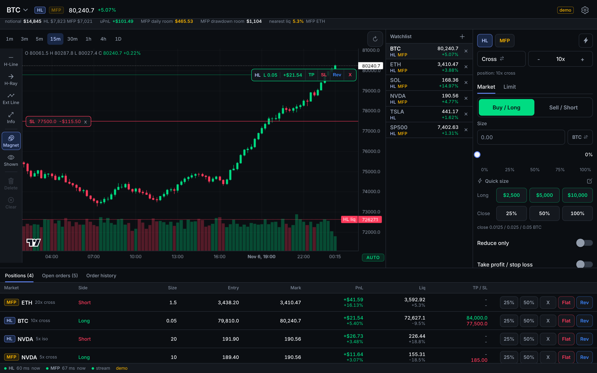
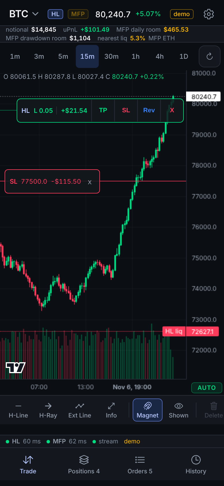
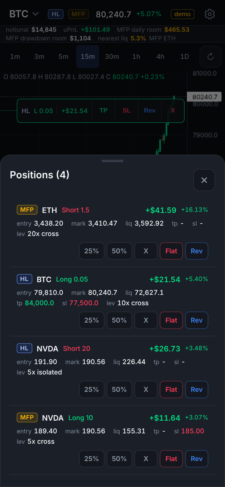

# terminal

A chart-first trading terminal for Hyperliquid perps (including HIP-3
equity perps) and MyFundedPerps (MFP) prop accounts. One Expo SDK 57
codebase with two layouts:

- a desktop browser layout, served on your own machine at 127.0.0.1 and
  never deployed anywhere;
- a phone layout (Android).

You trade from the chart: positions are tags on the price axis, take profit
and stop loss are lines you drag, and the order panel sits beside it.

An independent project. Not affiliated with or endorsed by Hyperliquid or
MyFundedPerps. Charts use TradingView Lightweight Charts.

This is a prototype (see "Status"). It can place real orders when you give
it keys. Read `docs/CONTRACT.md` before you do.

## Screenshots

All three are demo mode: mock venues, fake positions, synthetic candles.

Desktop, trade screen:



Phone, trade screen and the positions sheet:

 

## Demo mode (no account, no keys)

This is the way to try it. It needs Node and npm and nothing else
(developed on Node 25; the tests import TypeScript files directly and the
stream relay uses Node's built-in WebSocket, so use Node 22.18 or newer).

```
cd terminal
npm ci
npm run serve
```

`npm run serve` builds the web app into `dist-web/` and serves it on
127.0.0.1. Then open:

```
http://localhost:8088/?mock=1
```

`?mock=1` replaces both venues with a mock layer (`src/lib/mock_venue.ts`):
fake positions, orders, fills and balances, synthetic candles with a live
tick, no network and no keys. Orders "fill" or "rest" after a short
simulated delay, so the pending and confirmed states are visible. A "demo"
badge shows in the header and the status bar. Nothing you do in demo mode
can reach a venue. Ctrl+C in the terminal stops the server.

For the phone layout, narrow the browser window to about 390 px or use the
browser's device toolbar.

Options: `node server/serve.mjs` serves the last build without rebuilding;
`TT_PORT=9000 node server/serve.mjs` uses another port. Demo mode can also
be switched on in Settings ("Demo mode (mock venues)").

## Running with keys

```
npm run serve
```

Open http://localhost:8088 and put the keys in Settings (the gear, top
right):

- Hyperliquid: your wallet address (read only) and an API-wallet (agent)
  key. Never a master key; the app refuses a key whose address is the
  wallet's own.
- MyFundedPerps: a Read And Trade key scoped to one account, and on a live
  account a second, Read Only key for the reads.

Where keys live:

- Web: in that browser tab's memory only. They are entered again after a
  reload and are never written to localStorage, IndexedDB, cookies or the
  URL.
- Android: in the device secure store, behind the biometric prompt on every
  read (the MFP Read Only key is stored without the prompt so the poll is
  silent).

Why there is a local server: a browser cannot call MyFundedPerps directly
(its CORS policy allows one origin, MFP's own docs site). So the web build
sends its MFP requests to its own origin and a small pass-through in
`server/` forwards them. It forwards only the listed reads and writes,
sends one request per request with no retry and no redirect, answers its
own origin only, stores nothing and logs method, path and status only.
Hyperliquid is called directly. The server listens on 127.0.0.1 only; do
not expose it to a network.

## Safety model

The full specification is `docs/CONTRACT.md`. In short:

- A static guard (`scripts/check-exchange-guard.js`) pins the write
  surface: four Hyperliquid action types (order, cancel, modify,
  updateLeverage) and five MFP writes (create, modify, cancel, close,
  exit-orders), each venue's writes going out from one file through one
  `fetch`. It also pins the hosts, the pass-through's single send, the receive-only
  stream, where keys may be stored, and that no real-looking address or key
  is in the tree. Withdrawals, transfers, agent approval, vaults, spot,
  TWAP, cancel-all and close-all are not on the surface and fail the guard.
  A runtime assertion repeats the check before anything is signed or sent.
- Every write is sent once with a fresh idempotency id and is never
  retried. An uncertain result (timeout, 5xx, lost answer) is resolved by
  looking the order up by that id, never by sending again.
- Nothing is shown as done until a venue re-read, started after the venue's
  answer, shows the write's own effect. Until then it is drawn as pending.
  An unsettled write never expires by time and locks new exposure on that
  market; closing is never locked.
- Every order is held to a per-market max notional (default $1,000) and
  every market order to a slippage cap (default 1 percent, refused above 5
  percent).
- Closes can only reduce: reduce-only on Hyperliquid, the close endpoint on
  MFP. A close that would increase or flip a position is refused.
- MFP reads are counted per key against the venue's limit (60 GETs a
  minute live, 30 sandbox). Display reads are held back when the budget is
  short and the hold is shown; reads on the path of a close are always
  sent.
- MFP's account stream is receive-only and is used purely as a change
  signal: a frame means "read the venue now". Nothing pushed is shown as
  state or settles an order. On the web it is relayed by the local server,
  because a browser's WebSocket cannot carry the Authorization header and
  the key must never go in a URL.

A static check reads source text; it does not prove the absence of bugs.
The guard's own header lists what it cannot see.

## Checks

```
npm run check
```

runs, in order: `npm test` (392 tests, `node --test`, no network and no
real key), `npm run guard:exchange`, `tsc --noEmit`, and an Android bundle
export into `.export-check/` (ignored).

`test/exchange_guard.test.mjs` runs the guard against changed copies of the
source tree held in memory and requires each one to fail: a second sender,
a host joined from pieces, a built action type, an assertion moved into
dead code, a forbidden endpoint, a retry or a redirect in the pass-through,
a write on the stream, a key placed in an address or a log line, an import
that would let a pure module reach the key store.

Other scripts: `npm run web` (dev server with reload; it has no MFP
pass-through, so use demo mode) and `npm run shots` (web screenshots on the
mock layer, written to `shots/`; needs Playwright's Chromium).

## Status

Prototype.

- Done on a live venue: one MFP limit order placed, seen resting, and
  cancelled. The rest of the live test list (move, market order, TP / SL,
  partial and full closes, Flat, Reverse, and all of Hyperliquid) is open.
- Nothing has run on an Android device. The phone layout has only been
  seen in a browser.
- The MFP account stream's frames were checked read-only against the MFP
  sandbox. The web relay has not been run end to end in a browser against
  the real stream; it is tested against fakes.
- Some venue behaviour is taken from documentation and marked UNVERIFIED in
  the code.

If you use it with keys: small size, a low max notional, and the venue's
own screen open beside it.

## What is not included

- No hosted service, no accounts, no telemetry. There is nothing to deploy.
- No signals, scanning or strategy: the app draws and sends what you tell
  it to.
- No keys, no addresses, no real account data. Tests use fake keys and the
  Hyperliquid SDK's published test key only.
- No Android build is published and `eas.json` carries no project id; to
  build one you need your own Expo project.
- Development history, review notes and screenshots of real accounts were
  left out of this export.

Licence and security policy: `../LICENSE` and `../SECURITY.md`.
Third-party notices: `THIRD_PARTY_NOTICES.md`.
